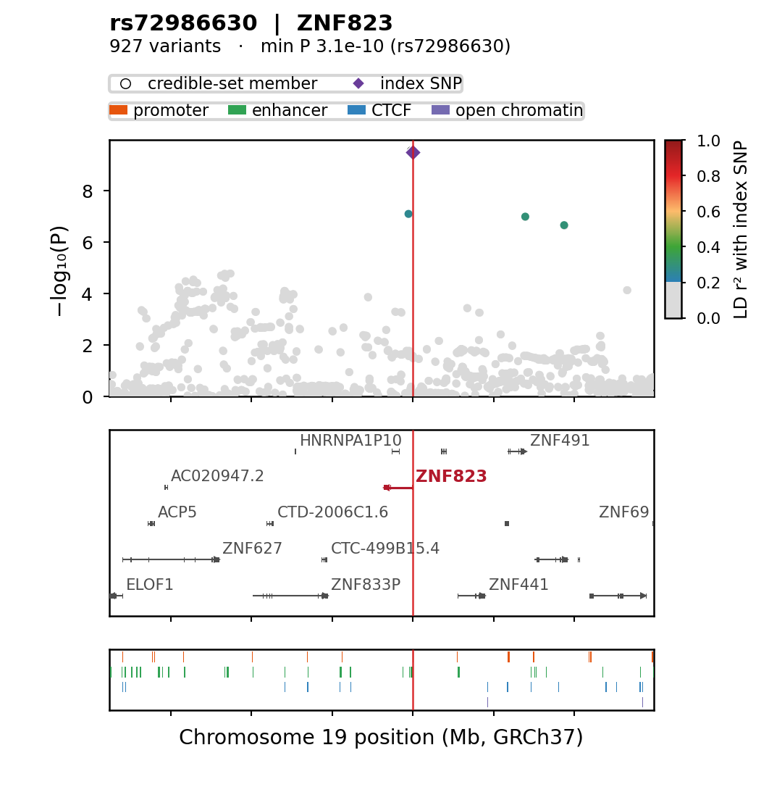
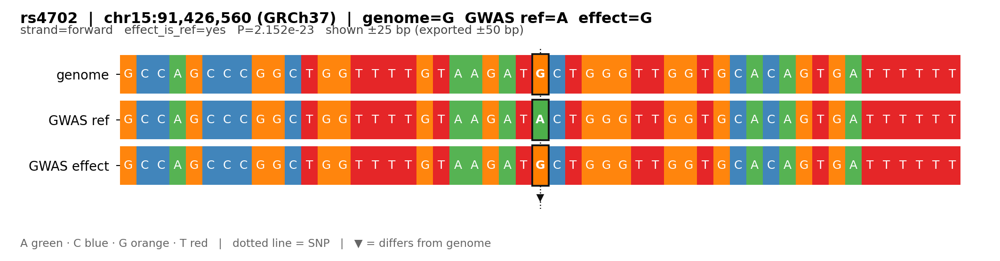

# locuskit

把 GWAS 位点画成可直接投稿的位点图，并导出位点附近的参考序列与等位序列。

给一个 lead SNP 和一个窗口，它输出一张 PDF：上半是关联曲线（按 LD r² 连续着色），
下面是基因模型与调控元件，翻页是变异明细表；同一个位点还能一键导出
**基因组参考 / GWAS 参考等位 / GWAS 效应等位**三条序列。

<p align="center">
  
  
</p>

## 特性

* **位点图**：LD r² 连续渐变或 credible-set PIP 着色、credible 成员空心圈、index SNP 标记、
  基因模型（带正负链箭头与名称）、Ensembl 调控元件、dlPFC 五类表观证据轨道
* **附表自动生成**：可信集 / r² 超阈值 / 窗口内显著变异 / 前 N 个最强信号，四种口径任选
* **序列导出**：SNP 两侧 ±x bp（x 自定），输出三条序列 + 碱基色块图，可批量
* **跨构建**：GRCh37 ↔ GRCh38 liftover；LD 面板不同构建时按 rsID 匹配
* **两种入口**：网页界面点点鼠标，或 YAML 配置批量跑几百个位点
* **依赖轻**：只要 `numpy` + `matplotlib` + `PyYAML`（网页界面另需 `Flask`），
  不需要 pandas、plink、pysam

## 安装

```bash
git clone https://github.com/LHJLab/locuskit.git
cd locuskit
pip install -r requirements.txt
```

验证：

```bash
python -m locuskit --help
python -m locuskit.cli --help
python -m locuskit.seq --help
```

> Python ≥ 3.9。用 conda 也可以：`conda install numpy matplotlib pyyaml flask`。

## 快速开始

位点、窗口、数据路径都由一份 YAML 声明。最小的配置长这样（`code/my_loci.yaml`）：

```yaml
gwas:
  path: data/003_SCZ_Nature2022/PGC3_SCZ_wave3.core.autosome.public.v3.vcf.tsv.gz
  columns: {chr: CHROM, pos: POS, id: ID, p: PVAL}

loci:
  path: my_loci.tsv          # 每行一个位点：index_snp  chrom  start  end
  columns: {index_snp: index_snp, chr: chrom, start: start, end: end}

output: {dir: figures}
```

```bash
# 1) 看看能画出哪些位点
python -m locuskit.cli code/my_loci.yaml --list

# 2) 先画一个试试
python -m locuskit.cli code/my_loci.yaml --only rs4702

# 3) 全部跑
python -m locuskit.cli code/my_loci.yaml
```

产物在 `figures/`：`FURIN_rs4702.pdf`（首页图 + 其后附表）与同名 `.png`。

仓库里已有四份可直接用的配置：

| 配置 | 数据 | 构建 | 特点 |
|---|---|---|---|
| `code/config_scz_v2.yaml` | PGC3 SCZ core | GRCh37 | LD + credible 圈 + 基因 + 调控 |
| `code/config_enc_scz.yaml` | SCZ european | GRCh38 | liftover + rsID 匹配 LD + **ENCODE 五轨** + `r²>0.8` 附表 |
| `code/config_mdd_v2.yaml` | PGC-MDD 2025 EUR | GRCh37 | `auto_loci` 自动识别 lead SNP |
| `code/config_nxph1_grch38.yaml` | MDD · NXPH1 | GRCh38 | liftover + 显著 SNP 附表 |

```bash
python -m locuskit.cli code/config_scz_v2.yaml --only rs72986630
```

## 用法

### 网页界面

```bash
python -m locuskit              # 打开 http://127.0.0.1:8088/
```

左侧选配置、填 SNP 与窗口、勾选轨道与附表，右侧实时预览 PNG 并给 PDF/PNG/SVG 下载。
「模式」切到**序列导出**后，可以批量填 SNP、设 ±bp、勾选是否出序列图。

```bash
python -m locuskit --port 9000          # 换端口
python -m locuskit --no-browser         # 不开浏览器（服务器上）
python -m locuskit --root /path/work    # 指定工作目录（含 code/ 与 data/）
```

### 命令行

```bash
python -m locuskit.cli cfg.yaml                   # 配置里的全部位点
python -m locuskit.cli cfg.yaml --only rs4702     # 单个
python -m locuskit.cli cfg.yaml --limit 3         # 前 3 个
python -m locuskit.cli cfg.yaml --list            # 只列位点
python -m locuskit.cli cfg.yaml --no-table        # 不出附表
python -m locuskit.cli cfg.yaml --outdir out --formats pdf,svg
```

### 序列导出

```bash
python -m locuskit.seq \
  --gwas   data/003_SCZ_Nature2022/PGC3_SCZ_wave3.core.autosome.public.v3.vcf.tsv.gz \
  --columns '{"chr":"CHROM","pos":"POS","id":"ID","a1":"A1","a2":"A2"}' \
  --fasta  data/001_GRCh37_DNA/Homo_sapiens.GRCh37.dna.chromosomes.fa \
  --snp    rs4702 rs3824754 rs1619283 \
  --flank  500 \
  --out    seqs.tsv --fasta-out seqs.fa --figure figs/
```

导出的三条序列都是**正链**（反向链数据会先取互补）：

| 序列 | 含义 |
|---|---|
| `genome` | 参考基因组 FASTA 原样 |
| `gwas_ref` | 把 GWAS 的参考/非效应等位写到 SNP 位点 |
| `gwas_effect` | 把 GWAS 的效应等位写到 SNP 位点 |

| 参数 | 说明 |
|---|---|
| `--flank` | 两侧各取多少 bp（默认 500，输出长度 `2*flank+1`） |
| `--view` | 出图时显示两侧多少 bp（默认 30，可小于 `flank`） |
| `--mark` | `upper`（侧翼小写、SNP 大写）/ `brackets`（`[G]`）/ `none` |
| `--effect-col` | 哪一列是效应等位：`a1`（默认）或 `a2` |
| `--ref-col` | 哪一列是参考等位；缺省取效应列的另一列 |
| `--snp-file` | 从文件批量读 rsID（每行一个） |
| `--figure DIR` | 每个 SNP 另存一张序列图（PDF + PNG） |

TSV 每行一个 SNP，含位置、参考碱基、两个等位、`strand_vs_genome`、
SNP 在序列中的偏移，以及三条序列本身。FASTA 每个 SNP 三条记录
（`>rsid|genome|…`、`|gwas_ref|…`、`|gwas_effect|…`）。

### 作为 Python 库

```python
from locuskit import scan_windows, LDPanel, GeneIndex, plot_locus, style

style()
recs, meta = scan_windows("PGC3.tsv.gz",
                          {"rs4702": ("5", 136_900_000, 137_900_000)},
                          columns={"chr": "CHROM", "pos": "POS", "id": "ID", "p": "PVAL"})
r = recs["rs4702"]

ld = LDPanel("1000G.EUR.QC.bed")
m = ld.lookup_rsid([x["id"] for x in r] + ["rs4702"])
r2 = ld.r2_to_index(m["rs4702"], [m.get(x["id"]) for x in r])

genes = GeneIndex.from_gtf("Homo_sapiens.GRCh37.87.gtf.gz", cache="cache/genes.pkl")
fig, info = plot_locus(r, chrom="5", index_snp="rs4702", r2=r2,
                       genes=genes.window("5", 136_900_000, 137_900_000),
                       highlight_genes={"FURIN"}, build_label="GRCh37",
                       figsize_mm=(90, 92))
fig.savefig("FURIN_rs4702.pdf")
```

## 需要准备的数据

| 数据 | 用途 | 必需性 |
|---|---|---|
| GWAS 汇总统计 | 关联曲线（P、等位、BETA/SE） | **必需** |
| 位点定义（位点表或 `auto_loci`） | 画哪些位点、窗口多大 | **必需**（二选一） |
| LD 参考面板（PLINK 三件套） | r² 着色、`r²>阈值` 附表 | 可选 |
| 基因注释 GTF | 基因轨道 | 可选 |
| 精细定位 credible set | 空心圈、PIP 着色、附表来源 | 可选 |
| Ensembl 调控元件 GFF3 | 调控轨道 | 可选 |
| ENCODE dlPFC peak + 证据表 | 表观证据轨道、附表证据列 | 可选 |
| liftover chain | 汇总统计与出图构建不同时 | 可选 |

**只有前两项是硬要求**；其余缺哪项，对应轨道或列自动消失，不会报错。

### 汇总统计

任意制表符分隔文本，`.gz` 可直接读，可用 `##` 注释行。**只有 `chr`/`pos`/`p` 必填**，
其余（`id`、`a1`、`a2`、`beta`、`se`、`maf`、`info`、`n`）有就用、没有就跳过。

列名不必固定，在配置里逐列映射。两份真实数据长这样：

```
# PGC3 SCZ（POS 在第 3 列；A1 是参考等位，BETA 对应 A1）
CHROM  ID          POS        A1  A2  FCAS   FCON   IMPINFO  BETA      SE      PVAL
8      rs62513865  101592213  C   T   0.932  0.928  0.954    0.01340   0.0171  0.4319

# PGC-MDD 2025（列名带 #；POS 在第 2 列；EA 是效应等位）
#CHROM  POS     ID           EA  NEA  BETA       SE      PVAL    FCAS   FCON
1       752566  rs3094315    G   A    0.00280    0.0047  0.5535  0.177  0.179
```

表头的井号数量不限：`CHROM`、`#CHROM`、`##CHROM`、`##Chr` 都能识别，
列名匹配忽略前导 `#` 与大小写。

### 位点表

```tsv
index_snp   chrom  start       end          genes
rs4146428   10     102441964   102841964    WNT8A
rs3824754   10     102654593   103054593
```

`index_snp` 与 `chrom` 必需；窗口给 `start`+`end`，或合并成 `window`（`chr:start-end`）；
`genes` 可选，用于高亮与文件命名。不想写位点表就设 `auto_loci: {enabled: true}`，
会按 P 值阈值与距离自动挑 lead SNP。

### 其他格式

* **LD 面板**：PLINK 的 `x.bed`/`x.bim`/`x.fam` 同名同目录，`.bim` 第 4 列是位置
* **GTF**：Ensembl GTF（含 `gene` 与 `exon` 行）
* **credible set**：TSV，至少要有 `index_snp` 与 rsID 列；有 PIP 列才上 PIP 颜色
* **调控元件**：Ensembl regulatory GFF3（第 3 列类型，第 4/5 列起止）
* **ENCODE**：每个 mark 一个子目录、内含若干 `.bed.gz`

## 配置参考

```yaml
build_label: GRCh38              # 图上显示的构建（只影响坐标轴与注释解读）
cache_dir: cache                 # 基因/peak 索引缓存

gwas:
  path: ...
  comment_prefix: "##"
  columns: {chr: CHROM, pos: POS, id: ID, p: PVAL, a1: A1, a2: A2,
            beta: BETA, se: SE, info: IMPINFO, n: NEFF, fcas: FCAS, fcon: FCON}

loci:                            # 与 credset / auto_loci 三选一
  path: my_loci.tsv
  columns: {index_snp: index_snp, chr: chrom, start: start, end: end, genes: genes}

credset:
  path: table2_credible.tsv
  columns: {index_snp: index_snp, id: rsid, chr: chromosome, pos: position,
            pip: finemap_posterior_probability}

liftover:                        # 汇总统计与 build_label 不同构建时
  chain: data/001_GRCh37_DNA/GRCh37_to_GRCh38.chain.gz
  reverse: false

ld:
  bed: 1000G.EUR.QC.bed
  match_by: rsid                 # position（同构建）| rsid（跨构建）

genes: {gtf: Homo_sapiens.GRCh38.116.gtf.gz, rows: 5, biotypes: null}

regulatory:
  gff: Homo_sapiens.GRCh38.regulatory_features.v112.gff3.gz
  types: [promoter, enhancer, CTCF_binding_site, open_chromatin_region]

encode:
  show: true
  peaks: .../dlPFC_panel/processed_data/01_peaks
  evidence: .../dlPFC_panel/snp_evidence/snp_evidence_wide.tsv
  marks: [H3K27ac, H3K4me3, H3K27me3, CTCF, DNase]
  datasets: 20

window: {flank_kb: 150, min_kb: 200, max_kb: 1500}
figure: {width_mm: 90, height_mm: 92, dpi: 300}
output: {dir: figures, formats: pdf, preview: true, gene_prefix: true}

table:
  enabled: true
  source: ld                     # credset | top | window | ld | none
  ld_cut: 0.8
  top_n: 50
  p_max: null
  page: A4L
```

| 段 | 不写会怎样 |
|---|---|
| `credset` | 无空心圈、无 PIP 着色 |
| `liftover` | 不做坐标变换（视为与 `build_label` 同构建） |
| `ld` | 纯灰点，无 r² 色标 |
| `genes` / `regulatory` | 无对应轨道 |
| `encode` | 无证据轨道、附表无证据列 |
| `table` | 不出附表 |

### 构建别搞混

一张图涉及四个坐标系，只有前两个由你显式提供：

| 角色 | 必须等于 `build_label`？ |
|---|---|
| GWAS 汇总统计 | ❌ 可不同，用 `liftover.chain` 桥接 |
| 位点表 `start`/`end` | ✅ 必须是 `build_label` 的坐标 |
| 基因 GTF / 调控 GFF | ✅ 必须与 `build_label` 一致 |
| LD 面板 | ❌ 可不同，但必须 `match_by: rsid` |

* 同构建：`build_label: GRCh37`、不写 `liftover`、`match_by: position`
* 37 数据出 38 图：`build_label: GRCh38` + `liftover.chain` + **GRCh38 的 GTF/GFF** + `match_by: rsid`

## 样式自定义

默认外观即"自动模式"，不改任何参数。要改就传 `style`：

```python
from locuskit import plot_locus, Style
plot_locus(..., style=Style(point_marker="s", point_size=10))
plot_locus(..., style={"ld_cmap": ["#ffffff", "#08306b"]})
plot_locus(..., style=Style.preset("poster", vline_style="--"))
```

```yaml
style:
  style_preset: poster           # default / minimal / poster / dark
  point_marker: "^"
  index_marker: "P"
  vline_style: ":"
```

可覆盖的主要键：

| 组 | 键 |
|---|---|
| 画布 | `width_mm` `height_mm` `dpi` `facecolor` `axes_facecolor` |
| 字体 | `font_size` `title_size` `subtitle_size` `axis_label_size` `tick_size` `gene_label_size` `legend_size` `cbar_label_size` |
| 散点 | `point_marker` `point_size` `point_alpha` `point_edge` `background_color` `draw_background_points` |
| 着色 | `ld_cmap` `ld_vmin` `ld_vmax` `pip_cmap` `ld_ticks` `ld_label` |
| index SNP | `index_marker` `index_size` `index_color` `index_label` `index_label_dy` |
| credible 圈 | `cred_marker` `cred_size` `cred_edge` `cred_edge_width` `cred_face` |
| 参考线 | `vline` `vline_color` `vline_width` `vline_style` `vline_alpha` |
| 基因 | `gene_color` `gene_hl_color` `gene_lw` `gene_exon_h` `gene_arrows` `gene_arrow_size` |
| 调控/证据 | `reg_colors` `encode_colors` `encode_datasets` |
| 布局 | `left` `right` `header_mm` `footer_mm` `gap_mm` `gene_row_mm` `hspace` |
| 脊线 | `spines`（如 `["left","bottom"]`）`spine_width` `grid` `grid_color` |

`ld_cmap` 三种写法：

```yaml
ld_cmap: viridis                          # matplotlib 色带名
ld_cmap: ["#ffffff", "#08306b"]           # 颜色序列
ld_cmap: [[0,"#d9d9d9"],[0.2,"#1d91c0"],[1,"#8c0d0d"]]   # 指定位置
```

> 低 LD 点是否可见取决于色带起点：默认前 20% 固定为 `#d9d9d9`，r²<0.2 仍是浅灰；
> 改成从白色起，低 LD 点就看不见了。

## 打包成可执行文件

给不装 Python 的人用。**数据不打进 exe**（`data/` 常几十 GB），
所以是「可执行文件 + 同级 `code/`、`data/`」的形式。

```bash
# Linux / macOS
python3 -m venv .venv-pack && . .venv-pack/bin/activate
python -m pip install numpy matplotlib flask pyyaml pyinstaller
python build_exe.py                 # → dist/locuskit-gui
```

```bat
:: Windows
python -m venv .venv-pack
.venv-pack\Scripts\activate.bat
python -m pip install numpy matplotlib flask pyyaml pyinstaller
python build_exe.py                 :: → dist\locuskit-gui.exe
```

> PyInstaller 不能交叉编译：要 `.exe` 必须在 Windows 上打。
> 务必用**干净 venv**（不要 `--system-site-packages`），否则 anaconda 的 numpy
> 会外链 MKL，打出的程序启动即报 `libmkl_core.so.2` 缺失；PyInstaller 请用 6.x。

分发目录：

```
locuskit-work/
├── locuskit-gui        ← 可执行文件
├── code/               ← config*.yaml
├── data/               ← 汇总统计、GTF、LD 面板…
└── figures_gui/        ← 出图写这里
```

双击可执行文件 → 自动打开 `http://127.0.0.1:8088/`。

## 排错

| 症状 | 原因 / 处理 |
|---|---|
| `无法确定列 ['chr','pos','p']` | 列名没对上：在 `gwas.columns` 里显式映射 |
| 窗口内 0 个变异、图空白 | 位点表用了另一套构建的坐标 |
| 峰不在 index SNP 附近 | GWAS 与位点表构建不一致，且没配 `liftover` |
| LD 几乎全灰 | 面板与数据不同构建，却用了 `match_by: position` |
| 基因名对不上 / 轨道空 | GTF 与 `build_label` 不一致 |
| 所有位置整体偏 ~40 kb | 37↔38 差异，换注释并补 `liftover` |
| 序列导出 `unmatched` | 两个等位都不匹配参考碱基 → 构建不符或多等位，需核对 |
| 序列导出 `indel_or_multiallelic` | 非单碱基等位，不做替换（`note` 列说明） |

## 限制

* LD 只做"相对某个 index SNP 的 r²"，不含 LD 聚类或条件分析。
* 用 EUR 面板给东亚数据上色属近似；面板里没有的变异保持灰点。
* 序列导出只处理单碱基替换，indel/多等位仅标注。
* 序列图的图内文字为英文（依赖字体不含中文字形）。

## 许可

MIT。
